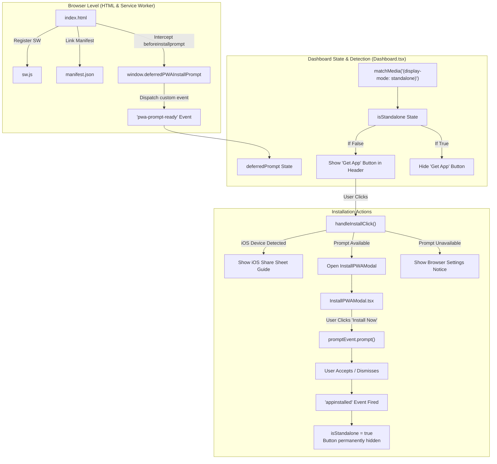

# Get App (PWA Installation) — Architecture & Developer Guide

The **Get App** feature in **Joe Partner Portal** implements Progressive Web Application (PWA) installation. It enables affiliate partners, marketers, and administrators to install the portal as a native-like standalone app on mobile devices (Android & iOS) and desktops (Windows, macOS, ChromeOS) without going through an app store.

---

## 1. System Overview & Key Principles

- **Zero App Store Overhead**: Users install the application directly from the web browser with a single click.
- **Standalone Window Experience**: When launched from the home screen or desktop, the app runs in `display: standalone` mode (no URL bar, no browser tabs, full-screen viewport).
- **Smart Visibility Control**: The **Get App** button automatically hides if the user is already viewing the portal from inside the installed app (`isStandalone === true`).
- **Cross-Platform Compatibility**:
  - **Chromium Browsers (Chrome, Edge, Brave, Android)**: Captures the native `beforeinstallprompt` event and presents a custom branded installation modal before triggering the native prompt.
  - **Apple iOS / iPadOS (Safari)**: Detects iOS devices and shows interactive step-by-step guidance (*"Tap Share, then select 'Add to Home Screen'"*).

---

## 2. System Architecture



---

## 3. Related Files & Responsibilities

> **Note:** Only base file names are shown for quick reference.

| File | Type | Role & Purpose |
|---|---|---|
| [`Dashboard.tsx`](file:///d:/Froent_end_Courses/FreeLancer/joepartner-portal/src/pages/Dashboard.tsx) | Page Component | Houses the "Get App" top navbar button, detects standalone mode, manages `deferredPrompt` listeners, handles iOS vs. Android/Desktop routing, and mounts `InstallPWAModal`. |
| [`InstallPWAModal.tsx`](file:///d:/Froent_end_Courses/FreeLancer/joepartner-portal/src/components/InstallPWAModal.tsx) | UI Modal Component | A branded modal with animations, app icon, key value propositions (*Fast Access, Native Feel, Secure*), and action buttons (*Install Now* vs. *Not Now*). |
| [`index.html`](file:///d:/Froent_end_Courses/FreeLancer/joepartner-portal/index.html) | HTML Entry Point | Intercepts `beforeinstallprompt` early on the window, dispatches `pwa-prompt-ready`, registers the service worker, and links `manifest.json`. |
| [`manifest.json`](file:///d:/Froent_end_Courses/FreeLancer/joepartner-portal/public/manifest.json) | Web App Manifest | Configures app identity: name, short name, start URL (`/`), standalone display mode, background color (`#090a0f`), theme color (`#10b981`), and icon definitions. |
| [`sw.js`](file:///d:/Froent_end_Courses/FreeLancer/joepartner-portal/public/sw.js) | Service Worker | Handles `install` (`skipWaiting`), `activate` (`clients.claim`), and basic `fetch` pass-through satisfying PWA installability requirements. |
| [`icon-192.png`](file:///d:/Froent_end_Courses/FreeLancer/joepartner-portal/public/icon-192.png) | Static Asset | 192x192 PNG app icon used by mobile launchers and the install modal. |
| [`icon-512.png`](file:///d:/Froent_end_Courses/FreeLancer/joepartner-portal/public/icon-512.png) | Static Asset | 512x512 high-resolution PNG app icon used for splash screens and high-DPI displays. |

---

## 4. Technical Lifecycle & How It Works

### Step 1: Early Prompt Capture & Service Worker Registration (`index.html`)
Modern browsers fire `beforeinstallprompt` as soon as the site meets PWA criteria. Because React may take several milliseconds to hydrate, `index.html` captures this event immediately in an inline script:

```html
<script>
  window.deferredPWAInstallPrompt = null;
  window.addEventListener('beforeinstallprompt', (e) => {
    e.preventDefault(); // Stop native banner from flashing automatically
    window.deferredPWAInstallPrompt = e;
    // Notify any React components that might already be listening
    window.dispatchEvent(new CustomEvent('pwa-prompt-ready', { detail: e }));
  });
</script>
<script>
  if ('serviceWorker' in navigator) {
    window.addEventListener('load', () => {
      navigator.serviceWorker.register('/sw.js');
    });
  }
</script>
```

---

### Step 2: Standalone Mode & Prompt Detection (`Dashboard.tsx`)
On component mount, `Dashboard.tsx` verifies if the application is already running as an installed PWA:

```typescript
// Check if already running in standalone mode (installed app)
if (window.matchMedia('(display-mode: standalone)').matches || (window.navigator as any).standalone) {
  setIsStandalone(true);
}

// Check if the global variable was set before this component mounted
if ((window as any).deferredPWAInstallPrompt) {
  setDeferredPrompt((window as any).deferredPWAInstallPrompt);
  setIsInstallable(true);
}
```

It also listens to:
1. `beforeinstallprompt`: For desktop/Android browsers that trigger it after mount.
2. `pwa-prompt-ready`: The custom event dispatched by `index.html`.
3. `appinstalled`: Triggered when installation completes, automatically setting `isStandalone = true` to hide the install button immediately.

---

### Step 3: Top Navigation "Get App" Button (`Dashboard.tsx`)
The button is rendered in the top bar right before the Language Selector, only when `!isStandalone`:

```tsx
{!isStandalone && (
  <button
    onClick={handleInstallClick}
    className="flex items-center gap-1.5 px-2 py-1.5 sm:px-3 sm:py-1.5 bg-blue-600 hover:bg-blue-700 text-white text-[10px] sm:text-xs font-bold rounded-xl transition shadow-sm animate-fade-in"
  >
    <LucideIcons.Download className="h-3 w-3 sm:h-3.5 sm:w-3.5" />
    <span className="hidden sm:inline">{t("تثبيت التطبيق", "Get App")}</span>
  </button>
)}
```

---

### Step 4: Click Handling & Platform Branching (`Dashboard.tsx`)
When the user clicks the "Get App" button, `handleInstallClick()` determines the platform:

```typescript
const handleInstallClick = () => {
  // 1. iOS Safari Branch
  const isIOS = /iPad|iPhone|iPod/.test(navigator.userAgent) && !(window as any).MSStream;
  if (isIOS) {
    toast.info(t("كيفية تثبيت التطبيق", "How to install"), {
      description: t(
        "اضغط على أيقونة المشاركة ثم 'إضافة إلى الشاشة الرئيسية'",
        "Tap Share icon, then select 'Add to Home Screen'"
      ),
      duration: 5000,
    });
    return;
  }

  // 2. Android / Chrome / Edge Branch
  const promptEvent = deferredPrompt || (window as any).deferredPWAInstallPrompt;
  if (promptEvent) {
    setIsInstallModalOpen(true);
  } else {
    // 3. Fallback when browser doesn't expose the prompt
    toast.info(t("كيفية تثبيت التطبيق", "How to install"), {
      description: t(
        "يمكنك تثبيت التطبيق من إعدادات المتصفح",
        "You can install the app from your browser settings"
      ),
    });
  }
};
```

---

### Step 5: The Branded Installation Modal (`InstallPWAModal.tsx`)
When `isInstallModalOpen` becomes `true`, `InstallPWAModal` renders an animated modal highlighting the benefits of installing:
- **Fast & Seamless Access** (`Zap` icon)
- **Feels Like a Native App** (`Smartphone` icon)
- **Secure & Reliable** (`Shield` icon)

When the user clicks **Install Now** (`تثبيت الآن`), it executes `handleActualInstall()`:

```typescript
const handleActualInstall = () => {
  const promptEvent = deferredPrompt || (window as any).deferredPWAInstallPrompt;
  if (promptEvent) {
    promptEvent.prompt(); // Triggers the browser's native installation confirmation
    promptEvent.userChoice.then((choiceResult: any) => {
      if (choiceResult.outcome === 'accepted') {
        setDeferredPrompt(null);
        (window as any).deferredPWAInstallPrompt = null;
        setIsInstallable(false);
      }
      setIsInstallModalOpen(false);
    });
  }
};
```

---

## 5. Web App Manifest Parameters (`manifest.json`)

The manifest defines how operating systems integrate the application:

```json
{
  "name": "Joe Partner Portal",
  "short_name": "JoePartner",
  "start_url": "/",
  "display": "standalone",
  "background_color": "#090a0f",
  "theme_color": "#10b981",
  "icons": [
    {
      "src": "/icon-192.png",
      "sizes": "192x192",
      "type": "image/png",
      "purpose": "any"
    },
    {
      "src": "/icon-512.png",
      "sizes": "512x512",
      "type": "image/png",
      "purpose": "any"
    }
  ]
}
```

- `display: standalone`: Hides all browser chrome (address bar, back button, bookmarks bar).
- `theme_color: #10b981`: Colors the mobile status bar and OS window title bar to match the brand.
- `start_url: /`: Ensures opening the app always starts at the root dashboard route.

---

## 6. Testing & Debugging PWA Installation

1. **Verify Manifest & Service Worker**:
   - Open Chrome DevTools (`F12`) → **Application** tab.
   - Inspect **Manifest**: verify Name, Icons, Start URL, and Display mode.
   - Inspect **Service Workers**: ensure `/sw.js` is active and running.
2. **Simulate Install Prompt**:
   - In DevTools → **Application** → **Manifest**, click **Install** to simulate the prompt trigger.
3. **Simulate Standalone Mode**:
   - In DevTools, click **Toggle device toolbar** (`Ctrl+Shift+M`) or test in Chrome by clicking the install icon in the URL omnibox.
   - Once installed, opening the app in its own window should automatically hide the "Get App" button from the header.
