# Payment Methods Guide (Users & Admins)

## 1. Overview & Architecture

The **Payment System** in IG-OS serves two distinct roles:

1. **User / Merchant Perspective (Payment Acceptance & Account Billing)**:
   - **Payment Acceptance**: Enables brand owners, creators, and freelancers to define how their customers pay them when purchasing digital products, services, or templates.
   - **Manual Transfer Methods**: Local peer-to-peer and wallet payments (e.g., Vodafone Cash, InstaPay, STC Pay, Bank Wire).
   - **Payment Gateways**: Automated payment processors for international cards and local checkout (e.g., Stripe, PayPal, PayTabs, Fawry).
   - **Account Billing**: Allows users to manage the card used to pay for their own IG-OS subscription.

2. **Admin & SuperAdmin Perspective (Platform Revenue & Subscription Management)**:
   - **Brand Admins**: Manage their brand's current subscription tier, track remaining days, monitor AI token and sub-user quotas, and submit renewal/upgrade requests.
   - **SuperAdmins**: Oversee global platform revenue, Monthly Recurring Revenue (MRR), conversion rates, and live transaction records across all client brands.

---

## 2. How Payment Methods Works for Users

### A. Configuring Customer Payment Acceptance (`PaymentMethodsPage.tsx`)
Located on the route `/payment-methods`, this page allows users to set up payment channels for their store and products:

#### 1. Manual Transfer Options (Local Wallets & Direct Transfer)
- **Supported Methods**:
  - `vodafone`: Vodafone Cash (Egypt)
  - `instapay`: InstaPay IPN (Egypt)
  - `etisalat`: Etisalat Cash (Egypt)
  - `orange`: Orange Cash (Egypt)
  - `bank`: Bank Account Wire Transfer
  - `stc`: STC Pay (Saudi Arabia / GCC)
- **Workflow**:
  1. The user selects a manual transfer provider from the interactive grid.
  2. The active selection is highlighted with the brand gradient.
  3. The user clicks the **Add Method** button.
  4. The selected method is appended to the active `addedMethods` list, displaying a green verified badge (`CheckCircle2`).
  5. Customers purchasing products can then be instructed to transfer money using these configured accounts.

#### 2. Professional Payment Gateways
- **Supported Providers**:
  - **Stripe**: International credit/debit card processing (Visa, Mastercard, Amex).
  - **PayPal**: Global digital wallet and checkout.
  - **PayTabs**: Middle East and GCC payment gateway supporting local cards (Mada, KNET, etc.).
  - **Fawry / Kashier**: Egyptian payment gateway for kiosk reference codes and local debit cards.
- **Workflow**:
  - Displays gateway connection status (e.g., `Disconnected`).
  - Clicking **Connect Account** initiates the OAuth or API key connection sequence to link the merchant account.

---

### B. User Account Billing & Card Management (`SettingsPage.tsx`)
Located on route `/settings`:
- **Current Plan Summary**: Displays the user's active IG-OS subscription, renewal date, and usage credits.
- **Payment Method Card**:
  - Shows masked card details (e.g., `VISA •••• 4242`).
  - Displays the last invoice date and amount paid.
  - Provides a **Edit Payment Method** button to update card credentials or change billing details.

---

## 3. How Payments & Subscriptions Work for Admin & SuperAdmin

### A. Brand Admin Subscription Management (`AdminPackagesPage.tsx`)
Located on route `/admin/packages`:
- **Active Subscription Overview**:
  - Displays the active tier (e.g., *Pro Business Plan* at `$299 / month`).
  - Visual indicators for active subscription status, price, and countdown of days remaining.
  - Summarizes plan limits: maximum sub-users and allocated monthly AI tokens.
- **Renewal & Upgrade Workflow**:
  1. Admin clicks **Upgrade / Renew Plan**.
  2. A modal opens with selectable tiers (*Creator Starter*, *Pro Business*, *Enterprise Unlimited*).
  3. Admin enters contact phone number and optional notes.
  4. Upon submission, the request is processed by `submitPlanRenewalRequest` in `adminSubscriptionService.ts`.
  5. The request is recorded in Firestore under `subscription_requests` with status `pending`, alerting sales and account managers.

### B. SuperAdmin Sales & Transaction Analytics (`SalesPage.tsx`)
Located on route `/superadmin/sales`:
- **Executive KPIs**:
  - **Total Revenue**: Cumulative revenue earned from subscriptions.
  - **MRR (Monthly Recurring Revenue)**: Predictable monthly income and growth rate.
  - **Active Subscriptions**: Total count of active paying brand accounts.
  - **Conversion Rate**: Percentage of free/trial users converting into paying subscribers.
- **Transaction Ledger (`salesService.ts`)**:
  - Reads from the `sales_transactions` Firestore collection.
  - Displays transaction IDs (`TX-9021`), client brand names, selected plans, amounts, timestamps, and real-time status badges (`completed`, `pending`, `failed`).

### C. Security & Access Control (`RoleGuard.tsx` & `App.tsx`)
- Standard users are restricted to `/payment-methods` and `/settings`.
- Brand Admins have access to `/admin/packages`.
- SuperAdmins have exclusive access to `/superadmin/sales`.

---

## 4. Key Files Associated with Payment Methods

All files are identified below by their file name:

| File Name | Primary Role | Description |
| :--- | :--- | :--- |
| `PaymentMethodsPage.tsx` | User UI Page | Allows users to configure manual payment methods (Vodafone Cash, InstaPay, STC, Bank) and connect payment gateways (Stripe, PayPal, PayTabs, Fawry). |
| `AdminPackagesPage.tsx` | Admin UI Page | Enables Brand Admins to view current package status, expiration countdown, quotas, and submit plan upgrade/renewal requests. |
| `SalesPage.tsx` | SuperAdmin UI Page | Dashboard displaying financial metrics (Revenue, MRR, Conversion) and real-time subscription transaction logs. |
| `SettingsPage.tsx` | User UI Page | Contains the user's personal billing card preview (`VISA •••• 4242`), invoice info, and "Edit Payment Method" action. |
| `adminSubscriptionService.ts` | Backend Service | Communicates with Firestore (`subscriptions` and `subscription_requests` collections) to fetch plans and submit renewal tickets. |
| `salesService.ts` | Backend Service | Fetches recorded subscription transactions from the `sales_transactions` Firestore collection. |
| `Sidebar.tsx` | Navigation Component | Houses navigation links and icons for `/payment-methods` (User menu) and `/admin/packages` (Admin menu). |
| `App.tsx` | Core Router | Configures application routes for `/payment-methods`, `/admin/packages`, and `/superadmin/sales` with role protection. |
| `RoleGuard.tsx` | Route Guard | Restricts route access by user role (`user`, `admin`, `superadmin`). |
| `en.ts` | Localization | Contains English translation keys and descriptions for payment methods, gateways, and billing labels. |
| `ar.ts` | Localization | Contains Arabic translation keys and descriptions for payment methods, gateways, and billing labels. |

---

## 5. Architectural Flow Diagram

```mermaid
graph TD
    subgraph User Space
        U[Creator / Store Owner] -->|Configures customer payment options| PM[PaymentMethodsPage.tsx]
        PM --> M[Manual: Vodafone Cash, InstaPay, STC Pay, Bank]
        PM --> G[Gateways: Stripe, PayPal, PayTabs, Fawry]
        U -->|Manages personal billing card| S[SettingsPage.tsx]
    end

    subgraph Admin Space
        A[Brand Admin] -->|Monitors plan & requests renewal| AP[AdminPackagesPage.tsx]
        AP -->|Calls submitPlanRenewalRequest| AS[adminSubscriptionService.ts]
        AS -->|Writes doc| FS_REQ[(Firestore: subscription_requests)]
    end

    subgraph SuperAdmin Space
        SA[SuperAdmin] -->|Monitors revenue & transactions| SP[SalesPage.tsx]
        SP -->|Calls fetchSalesTransactions| SS[salesService.ts]
        SS -->|Reads collection| FS_TX[(Firestore: sales_transactions)]
    end
```

---

## 6. Recommendations for Future Production Enhancements

1. **Persist User Payment Methods in Firestore**:
   - Currently, `addedMethods` in `PaymentMethodsPage.tsx` is held in local component state.
   - Recommended next step: Create a `userPaymentService.ts` to persist active payment methods and transfer account details (e.g. phone number for Vodafone Cash or InstaPay address) under `users/{userId}/payment_settings`.
2. **Gateway Webhook Integration**:
   - Integrate serverless Cloud Functions (e.g. in `functions/index.js`) to handle Stripe or PayTabs webhooks and automatically trigger product delivery or subscription renewal upon successful charge.
